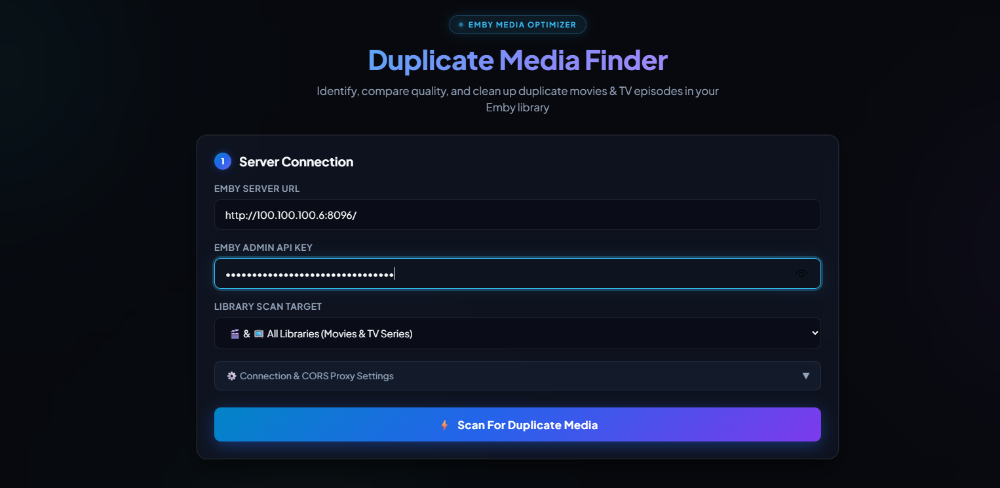
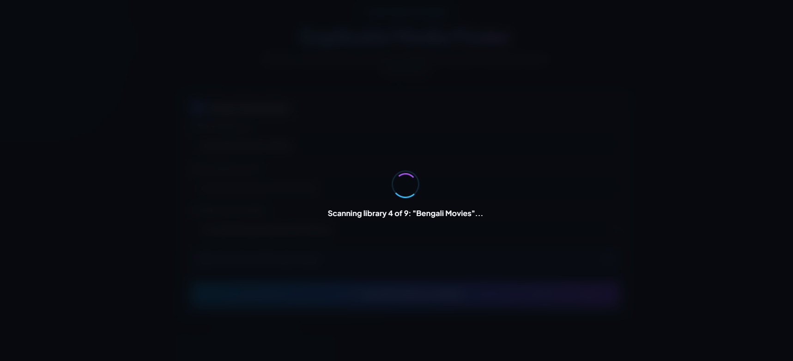
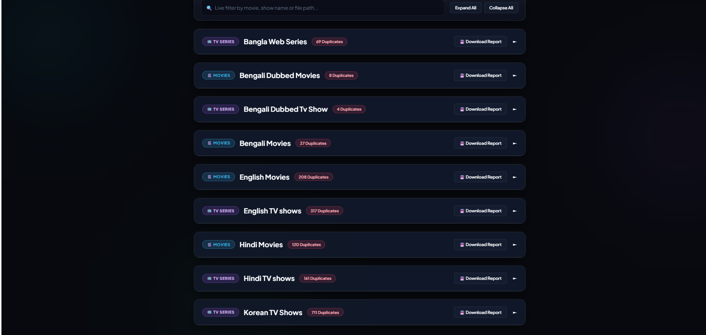
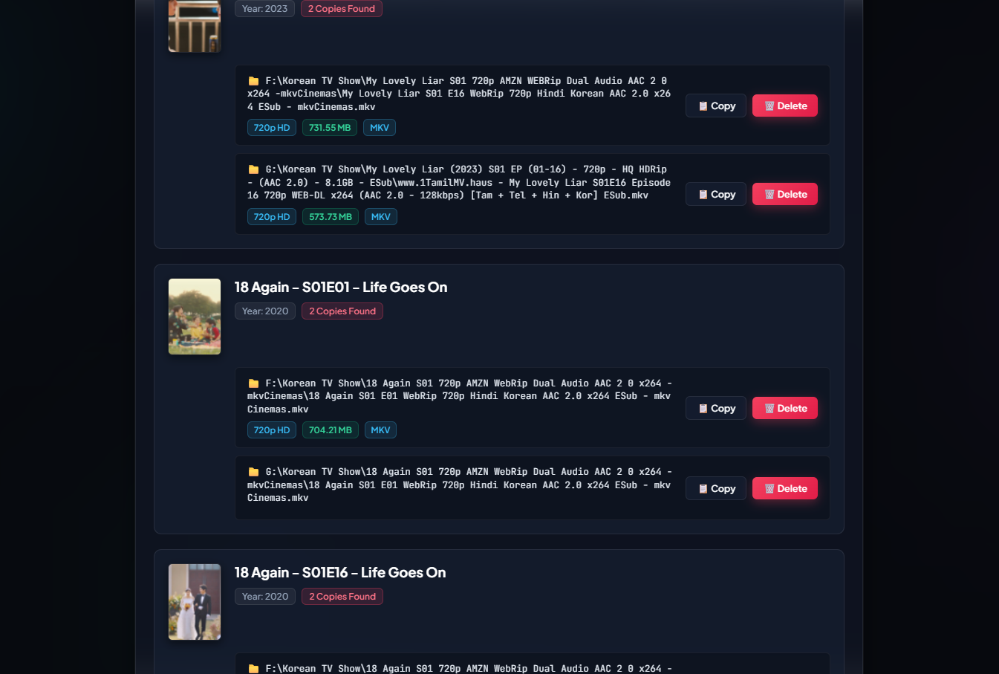
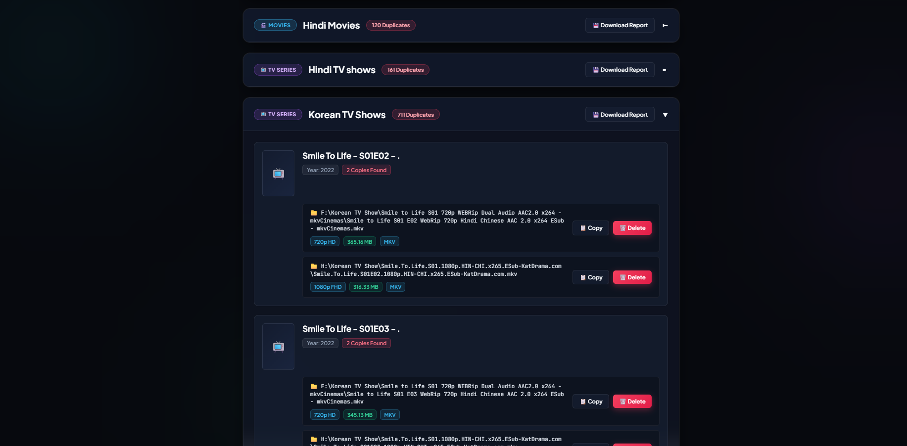

# 🎬 Emby Duplicate Finder

  

  
  
  
  

An ultra-modern, high-performance web tool designed for **Emby Media Server** to identify, compare quality, and clean up duplicate movies and TV series across all your media libraries.

---

## 🌟 Live Demo

You can try the web application directly in your browser without any installation:
👉 **[https://sohag1192.github.io/emby-duplicate-finder/](https://sohag1192.github.io/emby-duplicate-finder/)**

---

## 📸 Screenshots & Visual Tour

### 1. Connection Dashboard & Settings
Enter your Emby Server URL and API Key with full support for local IPs, domains, and HTTPS/HTTP CORS proxying.

---

### 2. Real-Time Library Scan Progress
Dual-ring animated progress indicator showing the exact library currently being analyzed.

---

### 3. Multiple Library Scan Overview
Clean accordion dashboard showing duplicate counts categorized by Movies and TV Series with one-click report downloads.

---

### 4. Duplicate Media Quality Comparison & Actions
Compare resolutions (1080p FHD vs 720p HD), file sizes, and container formats with one-click path copying and direct deletion.

---

### 5. Detailed Duplicate Inspection
Expand any library to inspect posters, release years, and copy counts.

---

## 🚀 Key Features

- **Movies & TV Series Support**:
  - Scans both Movie libraries and TV Shows/Episode libraries.
  - Matches TV episodes by Series Name, Season Number, and Episode Number (e.g. `S01E01`).
- **Smart Duplicate Detection**:
  - Detects duplicate files with identical titles and production years.
  - Detects multi-version files grouped under a single media item.
  - Detects misidentified media (same titles with differing release years).
- **Quality Specs Comparison**:
  - Visual badges for **4K UHD**, **1080p FHD**, **720p HD**, and **SD**.
  - Precise human-readable file sizes (MB / GB) and video containers (MKV, MP4, etc.).
- **Direct Management & Deletion**:
  - Safely delete redundant duplicate copies directly from your browser with interactive confirmation dialogs.
  - One-click copy for exact server file paths (`📋 Copy`).
- **Interactive Search & Filtering**:
  - Live real-time search to instantly filter detected duplicates by title or path.
  - Expand All / Collapse All controls.
- **CORS & Mixed Content Handling**:
  - Built-in secure CORS Proxy toggle for web browsers accessing local HTTP Emby servers from HTTPS GitHub Pages.
- **Downloadable Audit Reports**:
  - Export clean, formatted `.txt` reports listing all duplicates, file sizes, and paths per library.

---

## 🛠️ How to Use

1. **Open the App**:
   Visit [https://sohag1192.github.io/emby-duplicate-finder/](https://sohag1192.github.io/emby-duplicate-finder/) or open `index.html` locally in any modern browser.
2. **Enter Server Credentials**:
   - **Emby Server URL**: e.g., `http://192.168.1.100:8096` or `https://emby.yourdomain.com`.
   - **API Key**: Generated in **Emby Dashboard ➔ Advanced ➔ Security ➔ API Keys**.
3. **Select Scan Target**:
   Choose *All Libraries*, *Movies Only*, or *TV Series & Episodes Only*.
4. **Run Scan**:
   Click **⚡ Scan For Duplicate Media** and let it detect all redundant files.
5. **Review & Delete**:
   Compare the files, copy paths for verification, or click **🗑️ Delete** to free up disk space.

---

## ⚙️ Enabling Media Deletion in Emby

To allow deleting duplicate files directly from this web tool:
1. Open your **Emby Server Dashboard**.
2. Navigate to **Users** and click on your user profile.
3. Under **Media playback and deletion**, make sure **"Allow media deletion from clients"** is checked.
4. Click **Save**.

---

## 💡 Inspiration & Credits

- Inspired by [imahmud1/emby-dupe-finder](https://github.com/imahmud1/emby-dupe-finder). Special thanks to the original author for the concept!
- Developed & Enhanced by [sohag1192](https://github.com/sohag1192).

---

## 📄 License

This project is licensed under the [MIT License](LICENSE).
